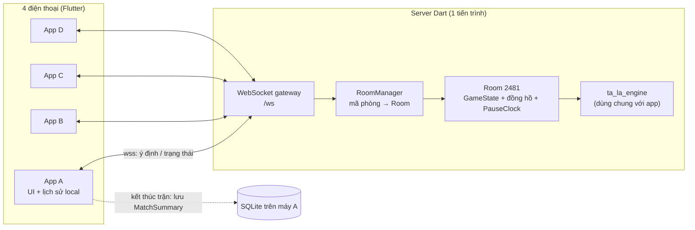
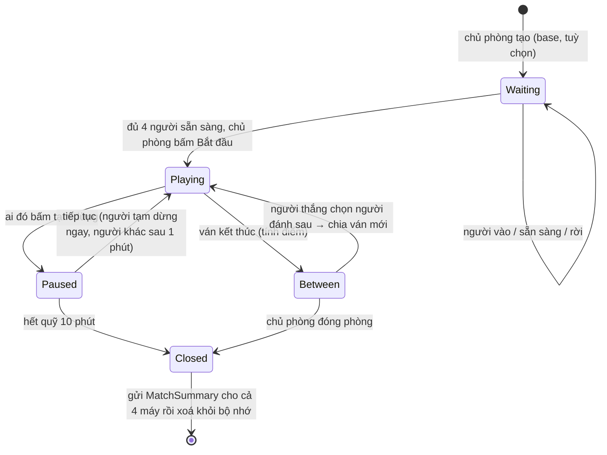

# Kiến trúc chơi online — đề xuất

> Mục tiêu: **4 người, 4 thiết bị, chơi qua internet trong 1 phòng**; **lịch sử trận lưu trên máy
> của từng người**. Tài liệu này giải thích lựa chọn, kiến trúc, giao thức và lộ trình làm.

---

## 1. Yêu cầu rút ra từ luật chơi

| Yêu cầu | Hệ quả kỹ thuật |
|---|---|
| Bài trên tay phải **bí mật** | Không thiết bị nào được giữ toàn bộ bài; phải có **một nơi trung lập** xáo bài và chia. |
| Luật phức tạp (ăn, chuyển bài, đền, Ù…) | Một nơi duy nhất **kiểm tra luật** để 4 máy không bao giờ lệch nhau. |
| Đồng hồ lượt 25 giây, tự đánh khi hết giờ | Đồng hồ phải chạy ở **một nơi** (không tin đồng hồ từng máy). |
| Quỹ tạm dừng 10 phút cả trận, người khác chờ 1 phút | Như trên: tính bằng **giờ server**. |
| Mạng điện thoại chập chờn | Phải **vào lại phòng** được, không mất ván. |
| Lịch sử lưu local | Server **không cần cơ sở dữ liệu**; chỉ gửi kết quả cho từng máy tự lưu. |

Kết luận: cần một **server trọng tài** (authoritative server). Đây là cách mọi game bài online đều
làm.

---

## 2. Các phương án

| Phương án | Ưu | Nhược | Đánh giá |
|---|---|---|---|
| **A. Server Dart tự viết** (WebSocket) | Dùng **thẳng** `ta_la_engine` đã viết + test; server là trọng tài thật; rẻ; không phụ thuộc nhà cung cấp | Phải tự deploy và chạy 1 server nhỏ | ✅ **Đề xuất** |
| B. Firebase (Firestore + Cloud Functions) | Không quản server; có sẵn đăng nhập | Cloud Functions chạy Node/TS → **phải viết lại toàn bộ luật** bằng TS (hoặc dịch Dart → JS, khá rối); giấu bài bằng security rules phức tạp; đồng hồ lượt khó làm chính xác | ⚠️ Không hợp vì đã có engine Dart |
| C. Một điện thoại làm "chủ" (P2P) | Không cần server | Qua internet phải xuyên NAT, gần như vẫn cần server trung gian; chủ phòng thoát là mất ván; chủ phòng **xem được bài người khác** | ❌ |
| D. Backend game có sẵn (Nakama, Colyseus…) | Có sẵn phòng, matchmaking | Viết logic bằng Go/Lua/TS, không phải Dart; học thêm nhiều thứ | ❌ Quá mức cần |

Game bài theo lượt **không cần độ trễ thấp kiểu game hành động**: 100–300 ms là thoải mái. Một
kết nối **WebSocket** (TCP, bảo mật bằng `wss://`) là đủ, không cần UDP.

---

## 3. Kiến trúc đề xuất



### 3.1 Các thành phần

| Thành phần | Vai trò |
|---|---|
| `packages/ta_la_engine` (đã có) | Luật chơi thuần Dart. Server dùng để **chạy ván**; app dùng để **gợi ý / xếp bài / bật tắt nút** ngay trên máy (không phải chờ server). |
| `packages/ta_la_protocol` (mới) | Định nghĩa **tin nhắn** client ↔ server và cách chuyển sang/từ JSON. Dùng chung cho app và server → hai bên không bao giờ lệch. |
| `server/` (mới) | Server Dart: nhận kết nối WebSocket, quản lý phòng, chạy đồng hồ, gọi engine, gửi trạng thái cho từng người. **Không có database**, mọi phòng nằm trong bộ nhớ. |
| `app/` (mới) | App Flutter: giao diện như artifact, kết nối server, lưu lịch sử trận bằng SQLite (Drift). |

### 3.2 Server là trọng tài

- Server xáo bài bằng `Random.secure()`, chia, giữ nọc.
- Client chỉ gửi **ý định** (`Bốc`, `Ăn`, `Đánh 7♥`, `Hạ phỏm…`). Server gọi
  `TaLaEngine.apply`; hợp lệ thì cập nhật, không hợp lệ thì trả lỗi (mã `RuleViolation`).
- Sau mỗi thay đổi, server gửi cho **từng người một bản trạng thái riêng** (*player view*): bài
  trên tay của chính mình, số lá của người khác, hàng bài đánh, phỏm trên bàn, điểm… **không
  bao giờ** gửi bài của người khác hay thứ tự nọc.
- Mỗi trạng thái có số phiên bản `version` tăng dần để client biết bản nào mới nhất.

### 3.3 Danh tính người chơi (không cần đăng nhập)

- Lần đầu mở app: sinh một `playerId` ngẫu nhiên, lưu trên máy, kèm **tên hiển thị** người dùng tự
  đặt. Không cần tài khoản, email hay mật khẩu.
- Khi vào phòng, server cấp một `seatToken` bí mật cho ghế đó. Mất mạng thì dùng `seatToken` để
  **ngồi lại đúng ghế**.
- Sau này muốn có đăng nhập (Google/Apple) thì thêm vào, không ảnh hưởng phần còn lại.

### 3.4 Vòng đời một phòng



- **Mã phòng** 4 chữ số, server sinh ngẫu nhiên và không trùng phòng đang mở.
- Phòng không có ai kết nối quá ~30 phút thì tự đóng (dọn bộ nhớ).

---

## 4. Giao thức tin nhắn (JSON qua WebSocket)

Mỗi tin nhắn có `type` và dữ liệu. Ví dụ:

**Client → Server**

| `type` | Dữ liệu | Ý nghĩa |
|---|---|---|
| `hello` | `playerId`, `name`, `seatToken?` | Mở kết nối; có `seatToken` là vào lại ghế cũ |
| `createRoom` | `base`, `chargeRegularEats`, `turnSeconds` | Tạo phòng |
| `joinRoom` | `code` | Vào phòng |
| `setReady` | `ready` | Sẵn sàng / huỷ |
| `chooseNext` | `seat` | Người đi đầu chọn người đánh sau (= chọn chiều) |
| `startGame` | — | Chủ phòng bắt đầu |
| `action` | `kind` (`draw` · `eat` · `discard` · `layDown` · `declareU` · `declareKhan`), `cards`, `melds`, `sends`, `clientSeq` | Thao tác trong ván |
| `pause` / `resume` | — | Tạm dừng / tiếp tục |
| `closeRoom` | — | Chủ phòng đóng phòng |

**Server → Client**

| `type` | Dữ liệu | Ý nghĩa |
|---|---|---|
| `welcome` | `seatToken`, `roomCode`, `seat` | Đã vào phòng |
| `lobby` | danh sách ghế, tên, sẵn sàng, cài đặt | Phòng chờ thay đổi |
| `state` | `version`, *player view* (xem 3.2), `turnDeadline`, `pause` | Trạng thái ván mới nhất |
| `event` | `kind` (`ate`, `transfer`, `u`, `den`, `timeout`…), chi tiết | Để app hiện thông báo/hiệu ứng |
| `rejected` | `clientSeq`, `reason` (mã `RuleViolation`) | Thao tác bị từ chối |
| `gameOver` | điểm từng khoản, xếp hạng | Kết thúc 1 ván (app hiện điểm cạnh tên 3 giây) |
| `matchClosed` | `MatchSummary` | Trận kết thúc → app lưu lịch sử |

Gửi **toàn bộ player view** mỗi lần (vài KB) thay vì gửi phần thay đổi: đơn giản, khó sai, vào
lại phòng là có ngay trạng thái đầy đủ.

---

## 5. Đồng hồ, mất kết nối, tạm dừng

- **Đồng hồ lượt chạy trên server.** Server gửi `turnDeadline` (giờ server); app tự đếm ngược để
  hiển thị. Hết giờ thì server gọi `playTimeout` (đã có trong engine): tự bốc rồi đánh lá
  ngoài phỏm.
- **Mất kết nối** không làm dừng ván: ghế vẫn giữ, đồng hồ vẫn chạy, hết giờ thì tự đánh. Người
  chơi mở lại app → `hello` với `seatToken` → nhận ngay `state` mới nhất và chơi tiếp.
  Người khác thấy biểu tượng "mất kết nối" trên ô tên người đó.
- **Tạm dừng** dùng `PauseClock` (đã có trong engine) với giờ server; server tự đóng phòng khi hết
  quỹ 10 phút.
- **Lệch giờ giữa máy và server:** khi kết nối, server gửi giờ hiện tại; app tính độ lệch một lần
  để đếm ngược cho đúng.

---

## 6. Lịch sử trận lưu trên máy

- Server không lưu gì lâu dài. Khi phòng đóng (chủ phòng đóng hoặc hết quỹ tạm dừng), server gửi
  `matchClosed` kèm **MatchSummary** cho cả 4 người:
  `mã phòng, thời gian, base, người chơi (tên), điểm từng ván, tổng điểm cuối, lý do kết thúc`.
- App lưu vào **SQLite** trên máy (thư viện Drift). Màn "Lịch sử trận" đọc từ đây.
- **Không mất lịch sử khi rớt mạng giữa chừng:** sau **mỗi ván**, app lưu luôn bảng điểm tạm
  (trạng thái "đang chơi"). Nếu không nhận được `matchClosed` (VD máy tắt hẳn), lịch sử vẫn có
  các ván đã chơi, đánh dấu "chưa kết thúc".
- Xoá app là mất lịch sử. Muốn giữ lâu dài thì sau này thêm nút **xuất/nhập file** hoặc sao lưu lên
  cloud.

---

## 7. Bảo mật và chống gian lận (mức vừa đủ cho chơi với bạn bè)

- Luôn dùng `wss://` (TLS) — nhà cung cấp hosting cấp chứng chỉ miễn phí.
- Server kiểm tra mọi thao tác bằng engine; client sửa app cũng không đánh được bài không có.
- Không gửi bài người khác/thứ tự nọc xuống máy → không thể "nhìn trộm" kể cả khi đọc gói tin.
- Giới hạn số tin nhắn mỗi giây mỗi kết nối, giới hạn kích thước tin nhắn.

---

## 8. Hạ tầng và chi phí

| Hạng mục | Gợi ý | Chi phí ước tính |
|---|---|---|
| Chạy server | **Fly.io** hoặc **Railway** (đóng gói Docker, 1 máy nhỏ), hoặc VPS 1 GB | ~0 – 5 USD/tháng |
| Tên miền | Không bắt buộc (dùng tên miền nhà cung cấp cấp sẵn) | 0 – 12 USD/năm |
| Database | **Không cần** | 0 |

Một tiến trình Dart nhỏ chịu được hàng trăm phòng cùng lúc. Chỉ khi có rất nhiều người chơi mới
cần chạy nhiều máy (chia phòng theo mã) — chưa cần nghĩ tới bây giờ.

---

## 9. Cấu trúc thư mục dự kiến

```
packages/
  ta_la_engine/      # đã có: luật chơi
  ta_la_protocol/    # tin nhắn + JSON, dùng chung
server/              # Dart: WebSocket, RoomManager, đồng hồ
app/                 # Flutter: UI, kết nối, lịch sử SQLite
docs/
```

---

## 10. Lộ trình làm (đề xuất)

1. **`ta_la_protocol`**: định nghĩa tin nhắn + player view, test chuyển JSON hai chiều.
2. **Server tối thiểu**: tạo/vào phòng, chơi 1 ván đầy đủ bằng engine. Test bằng **4 client giả
   lập** chạy cùng tiến trình (không cần điện thoại) — chơi tự động hàng trăm ván.
3. **App Flutter**: dựng các màn theo artifact, ban đầu nối với một **server giả trong máy** để làm
   giao diện mà chưa cần mạng.
4. **Nối app với server thật** chạy trên máy tính, chơi thử 4 máy trong cùng Wi-Fi.
5. **Đồng hồ, hết giờ, tạm dừng, vào lại phòng** — test bằng cách tắt mạng giữa ván.
6. **Lịch sử trận** (SQLite) + màn Lịch sử.
7. **Deploy** lên Fly.io/Railway, chơi thử qua 4G.

---

## 11. Cần quyết định

| # | Câu hỏi | Đề xuất |
|---|---|---|
| 1 | Dùng server Dart tự viết (phương án A)? | Có |
| 2 | Có cần đăng nhập không? | Chưa — chỉ cần tên hiển thị + mã thiết bị |
| 3 | Nơi chạy server | Fly.io (có gói rẻ, hỗ trợ WebSocket, deploy bằng Docker) |
| 4 | Người mất kết nối: giữ ghế bao lâu? | Giữ suốt trận; hết giờ lượt thì tự đánh như luật 12.6 |
| 5 | Ai được đóng phòng? | Chủ phòng (giữa các ván); hoặc tự đóng khi hết quỹ tạm dừng |
